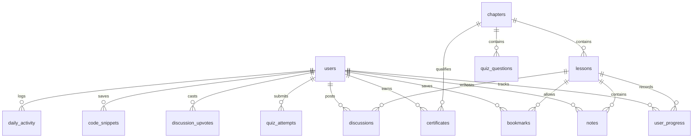

# 🎓 IT Beginner — Full-Stack Educational Learning Platform

[](https://nodejs.org/)
[](https://expressjs.com/)
[](https://www.sqlite.org/)
[](LICENSE)

A modern, production-grade educational web application built specifically for the **IT Beginner** curriculum (42 comprehensive video lessons across 6 chapters). Modeled after leading LMS platforms (Coursera, Scrimba, Udemy), the platform integrates video streaming, an in-browser live code sandbox, threaded community discussions, interactive quizzes, automated streak tracking, and verifiable printable certificates of completion.

---

## 📑 Table of Contents

- [Core Features](#-core-features)
- [Curriculum & Course Structure](#-curriculum--course-structure)
- [Architecture & Tech Stack](#-architecture--tech-stack)
- [Database Schema](#-database-schema)
- [API Reference](#-api-reference)
- [Video Player & Keyboard Shortcuts](#-video-player--keyboard-shortcuts)
- [Getting Started](#-getting-started)
- [Default Demo Credentials](#-default-demo-credentials)
- [License](#-license)

---

## 🚀 Core Features

### 🔐 1. Authentication & Session Management
- **Secure Registration & Login**: Validated inputs with unique username/email constraints.
- **Password Hashing**: `bcryptjs` with 10 salt rounds for secure password storage.
- **Session Security**: `express-session` with 7-day cookie persistence and `httpOnly` security flags.
- **Role-Based Access Control**: Middleware (`requireAuth`, `requireAdmin`) restricting protected learning zones and the administrative suite.

### 📊 2. Student Learning Hub & Dashboard (`/dashboard`)
- **Key Metrics Overview**: Real-time counters for Completed Lessons, In-Progress Lessons, Total Lessons, and Overall Completion %.
- **Daily Study Streak**: Automated streak calculation (`🔥 Nd Streak`) based on consecutive days with lesson views or quiz submissions.
- **Visual Progress Tracking**: Real-time animated progress bars for overall curriculum and individual chapters.
- **Recently Watched Widget**: One-click resume functionality jumping directly to the saved second where the user paused.
- **Bookmarked Lessons**: Quick-access drawer for bookmarked lectures.

### 📹 3. Native Video Streaming Engine (`/lesson/:id`)
- **HTTP Byte-Range Audio/Video Streaming**: Streams native MP4 video files directly from local storage with random seeking support (`Accept-Ranges: bytes`).
- **Auto-Resume & Position Tracking**: Automatically records timestamp every 10 seconds and restores the exact position upon returning.
- **Auto-Completion**: Automatically marks lessons as completed when the video reaches the end.
- **Playback Speeds**: Quick-toggle between `1x`, `1.25x`, `1.5x`, and `2x`.
- **Keyboard Shortcuts**: Power user shortcuts for play/pause, seeking, muting, and fullscreen.

### 💬 4. In-Lesson Community Q&A & Discussions
- **Threaded Discussions**: Students can post lesson-specific questions and reply to peer discussions.
- **Instructor Badges**: Verified `👨‍🏫 Instructor` badge automatically applied to questions/replies from administrators.
- **Upvoting System**: Community upvote buttons with live counters and database-backed toggle states.
- **In-Lesson Scratchpad**: Mini interactive JavaScript execution environment directly below the video player so students can test concepts without pausing or switching tabs.
- **Timestamped Notes**: Create notes tied to the current video timestamp with one-click seek to that timestamp.

### 💻 5. In-Browser Interactive Code Playground (`/playground`)
- **Multi-Language Tabbed Editor**: Live tabs for HTML, CSS, and JavaScript.
- **Isolated Preview Sandbox**: Secure `<iframe>` execution rendering DOM changes instantly.
- **Console Interception**: Captures and displays `console.log()`, `console.warn()`, and `console.error()` inside an integrated terminal UI.
- **4 Curriculum Practice Presets**:
  1. *Variables & Data Types* (Modern `let`/`const` & string interpolation)
  2. *Conditionals & Logic* (Score grader with comparison operators)
  3. *Arrays & Loops* (Dynamic list generation with `.forEach()`)
  4. *HTML & CSS Profile Card* (Responsive flexbox layout & styling)
- **Snippet Cloud Storage**: Save, retrieve, and delete personal code snippets in the SQLite database.

### 🔍 6. Search & Multi-Criteria Filtering (`/search`)
- **Global Search**: Search across all 42 lessons by title and description.
- **Multi-Filter Bar**: Simultaneously filter by chapter (Chapters 1 to 6) and learning status (*All*, *Completed*, *In Progress*, *Not Started*, *Bookmarked*).
- **Autocomplete JSON API**: Fast typeahead query endpoint at `/api/search?q=...`.

### 📖 7. Cheatsheets & Reference Guides (`/resources`)
- **JavaScript Handbook**: Variable scoping, data types, strict equality (`===`), array methods, object notation.
- **HTML5 & CSS3 Reference**: Semantic page structure, CSS Box Model, Flexbox layout axes.
- **Agile & Scrum Quick Reference**: The 4 Agile values, Scrum ceremonies (Planning, Standup, Review, Retrospective), Jira workflows.
- **Command Line (CLI) & NPM**: Terminal navigation (`pwd`, `cd`, `ls`), file operations, and `package.json` package management.

### ❓ 8. Interactive Chapter Quizzes (`/quizzes` / `/quiz/:chapterId`)
- Multi-question assessment modules across all chapters.
- Immediate visual validation (green for correct, red for incorrect) with in-depth technical explanations.
- Persistent attempt logging with user score recalculation.

### 🏆 9. Verifiable & Printable Certificates (`/certificate/:code`)
- **Automated Issuance**: Automatically unlocks when a student completes 100% of the lessons in a chapter.
- **Public Verification**: Shareable URL (`/certificate/:code`) accessible without authentication.
- **Print & PDF Layout**: Clean `@media print` CSS styling for high-resolution A4/Letter credentials with official gold seal and unique verification code.

### 🛡️ 10. Admin Control Center (`/admin`)
- Accessible only to accounts with `role: 'admin'`.
- **System Telemetry**: Total registered users, lesson completions, quiz pass rates, active discussions, and issued certificates.
- **Student Roster**: User list with progress bars, completed lesson counts, notes counts, and join dates.
- **Role Elevation**: One-click toggle between Student and Administrator roles.
- **Engagement Feed**: Most-viewed lessons and live stream of recent quiz attempts.

---

## 📚 Curriculum & Course Structure

The platform organizes 42 lessons into 6 structured chapters:

| Chapter | Title | Lessons | Key Concepts Covered |
|:---:|---|:---:|---|
| **1** | 🚀 Getting Started | 3 | Welcome, Course Overview, Curriculum, Resources |
| **2** | ⚙️ Software Development Basics | 3 | Software Lifecycle, Agile Methodology, Scrum, Jira Backlog |
| **3** | 🌐 Web Development Fundamentals | 16 | How Websites Work, JS Variables, Conditionals, Objects, Arrays, Loops, Functions, HTML5, CSS3, DOM |
| **4** | 🛠️ Frontend Development & Tools | 14 | Demo App, Frameworks, Open Source, NPM Registry, SemVer, CLI, NPM on macOS/Windows, Installing Libraries |
| **5** | ⚡ Vue.js Framework & Reactive Apps | 5 | Vue.js Core Concepts, Directives, Reactivity, State, Frontend Implementation with Vue |
| **6** | 🔌 Full-Stack Architecture & Backend | 1 | Client-Server Architecture, HTTP Methods, REST APIs, JSON Exchange |

---

## 🏗️ Architecture & Tech Stack

```
it-beginner-website/
├── server.js              # Express 5 server configuration & route mounting
├── package.json           # Dependencies, scripts, and project metadata
├── db/
│   ├── database.js        # SQLite setup (WAL mode), schema definitions, seeders
│   └── learning.db        # SQLite database (auto-generated)
├── middleware/
│   └── auth.js            # Authentication guards & streak calculation
├── routes/
│   ├── auth.js            # Login, register, logout controllers
│   ├── dashboard.js       # Main dashboard & KPI aggregations
│   ├── course.js          # Chapters, lesson streaming, progress & discussion APIs
│   ├── playground.js      # Code playground presets & snippet persistence
│   ├── search.js          # Multi-criteria search and filter controller
│   ├── resources.js       # Curriculum cheatsheets and technical guides
│   ├── quiz.js            # Quiz presentation & submission evaluation
│   ├── profile.js         # User profile, password security, certificate claiming
│   ├── certificate.js     # Public certificate verification controller
│   └── admin.js           # Admin telemetry & student roster controller
├── views/
│   ├── partials/
│   │   ├── head.ejs       # Common HTML headers & typography
│   │   ├── sidebar.ejs    # Responsive navigation bar & streak indicator
│   │   └── footer.ejs     # Script inclusions & closing tags
│   ├── landing.ejs        # Public marketing landing page
│   ├── login.ejs          # Sign-in form
│   ├── register.ejs       # Account registration form
│   ├── dashboard.ejs      # Authenticated user dashboard
│   ├── courses.ejs        # All chapters overview
│   ├── chapter.ejs        # Chapter curriculum checklist
│   ├── lesson.ejs         # Enhanced video player, Q&A, Scratchpad, Notes
│   ├── playground.ejs     # Interactive HTML/CSS/JS sandbox IDE
│   ├── search.ejs         # Search & filter interface
│   ├── resources.ejs      # Developer cheatsheets & guides
│   ├── quiz.ejs           # Chapter assessment quiz
│   ├── profile.ejs        # Account settings & credentials gallery
│   ├── certificate.ejs    # Official verifiable certificate of completion
│   ├── admin.ejs          # Administrator control center & roster
│   └── error.ejs          # 404 / 403 error page
└── public/
    ├── css/
    │   └── styles.css     # Dark mode design system & print styles
    └── js/
        └── app.js         # Client-side notifications & utility helpers
```

---

## 🗄️ Database Schema

The database uses SQLite with **WAL (Write-Ahead Logging)** mode enabled for high concurrency:



### Table Specifications:
- `users`: ID, username, email, `password_hash`, `full_name`, avatar, role (`student` / `admin`), timestamps.
- `chapters`: ID, title, description, `order_index`, icon.
- `lessons`: ID, `chapter_id`, title, description, `video_filename`, `order_index`.
- `user_progress`: ID, `user_id`, `lesson_id`, status (`not_started`, `in_progress`, `completed`), `progress_percent`, `last_position_seconds`, timestamps.
- `notes`: ID, `user_id`, `lesson_id`, content, `timestamp_seconds`, timestamps.
- `bookmarks`: ID, `user_id`, `lesson_id`, created timestamp.
- `discussions`: ID, `lesson_id`, `user_id`, `parent_id` (threaded), content, upvotes, timestamps.
- `discussion_upvotes`: ID, `discussion_id`, `user_id` (unique composite index).
- `quiz_questions`: ID, `chapter_id`, `lesson_id`, question, 4 options, `correct_option`, explanation.
- `quiz_attempts`: ID, `user_id`, `question_id`, `selected_option`, `is_correct`, attempted timestamp.
- `certificates`: ID, `user_id`, `chapter_id`, `certificate_type`, `certificate_code` (unique), issued timestamp.
- `code_snippets`: ID, `user_id`, title, `html_code`, `css_code`, `js_code`, timestamps.
- `daily_activity`: ID, `user_id`, `activity_date`, `time_spent_seconds`, `lessons_completed`, `quizzes_completed`.

---

## 🔌 API Reference

### Progress & Bookmarks
- `POST /api/progress/:lessonId` — Update playback position and completion status.
- `POST /api/bookmark/:lessonId` — Toggle lesson bookmark.

### Notes
- `POST /api/notes/:lessonId` — Save timestamped note.
- `DELETE /api/notes/:noteId` — Delete note by ID.

### Community Q&A
- `POST /api/discussions/:lessonId` — Post new question or threaded reply.
- `POST /api/discussions/:discussionId/upvote` — Toggle upvote on discussion post.
- `DELETE /api/discussions/:discussionId` — Delete discussion post (author or admin).

### Code Playground
- `POST /api/playground/save` — Save or update custom code snippet.
- `GET /api/playground/snippet/:id` — Retrieve saved snippet by ID.
- `DELETE /api/playground/snippet/:id` — Delete saved snippet.

### Assessments & Certification
- `POST /api/quiz/submit` — Submit quiz question answer and receive explanation.
- `POST /api/certificate/claim` — Generate and record certificate for completed chapter.

### Search
- `GET /api/search?q={query}` — Returns JSON array of matched lessons for live autocomplete.

### Administration
- `POST /api/admin/toggle-role/:userId` — Toggle user role between `student` and `admin`.

---

## ⌨️ Video Player & Keyboard Shortcuts

| Shortcut | Action |
|:---:|---|
| <kbd>Space</kbd> or <kbd>K</kbd> | Toggle Play / Pause |
| <kbd>←</kbd> (Left Arrow) | Seek backward 5 seconds |
| <kbd>→</kbd> (Right Arrow) | Seek forward 5 seconds |
| <kbd>M</kbd> | Toggle Mute / Unmute |
| <kbd>F</kbd> | Toggle Fullscreen mode |

---

## 🛠️ Getting Started

### Prerequisites
- [Node.js](https://nodejs.org/) (v18.0.0 or higher)
- [npm](https://www.npmjs.com/) (v9.0.0 or higher)

### Installation

1. **Clone the repository**:
   ```bash
   git clone git@github.com:AjinLab/it-beginner-website.git
   cd it-beginner-website
   ```

2. **Install dependencies**:
   ```bash
   npm install
   ```

3. **Course Video Files**:
   Ensure the video files reside in `../IT_BEGINNER` relative to the project directory:
   ```
   LEARN/
   ├── IT_BEGINNER/          # 42 MP4 video files
   └── it-beginner-website/  # Web application
   ```

4. **Launch the application**:
   ```bash
   npm start
   ```

5. **Open in browser**:
   Navigate to [http://localhost:3000](http://localhost:3000).

---

## 👤 Default Demo Credentials

| Role | Email | Password | Permissions |
|---|---|---|---|
| **Admin** | `admin@itbeginner.com` | `admin123` | Full access + `/admin` analytics & student roster |
| **Student** | Register your own at `/register` | Self-selected | Standard student learning dashboard |

---

## 📄 License

This project is licensed under the MIT License — see the [LICENSE](LICENSE) file for details.
